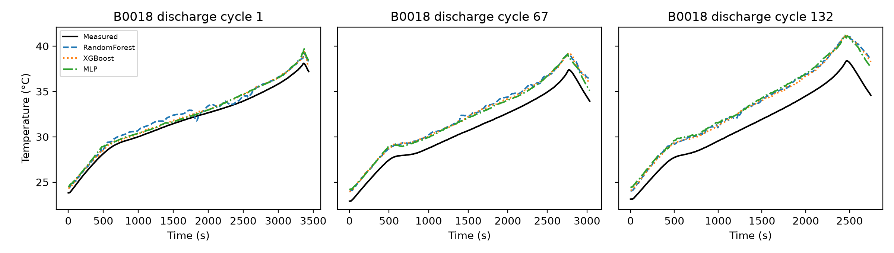
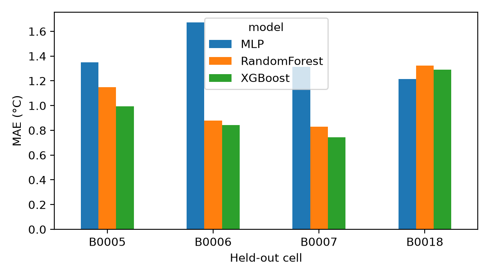
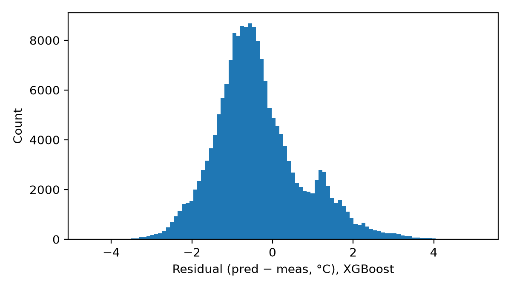

# AI-Driven Predictive Thermal Management for Electric Vehicle Battery Systems Using Lightweight Machine Learning

*Anonymous submission for double-blind review — ICCAQI 2026, Track: Artificial Intelligence and Machine Learning*

## Abstract

Battery temperature governs the safety, ageing and cooling demand of electric-vehicle (EV) energy storage, yet a battery management system (BMS) can afford only a few temperature sensors and modest compute. This paper asks whether lightweight machine-learning models can estimate cell temperature from electrical measurements alone, accurately and quickly enough to support thermal-management decisions, when applied to a cell they have never seen. Using 185,721 discharge samples from four 18650 lithium-ion cells (B0005, B0006, B0007, B0018) of the NASA Prognostics Center of Excellence Battery Data Set, we compare a Random Forest (RF), XGBoost, and a two-hidden-layer multilayer perceptron (MLP, 865 parameters) under strict leave-one-battery-out (LOBO) evaluation. Inputs are measured voltage and current plus engineered power, cumulative discharged energy and charge, voltage drop, elapsed time, ambient temperature, and cycle index; no temperature history is used. XGBoost gave the lowest mean error (MAE 0.97 °C, RMSE 1.16 °C, R² 0.906), followed by RF (MAE 1.05 °C, R² 0.892) and the MLP (MAE 1.39 °C, R² 0.835), against a training-mean baseline with MAE 3.34 °C. Worst-case absolute errors were 3.0–5.2 °C across folds. The models occupy 1.4 MB (XGBoost), 41 MB (RF) and 31 kB (MLP), and single-sample inference took 0.12 ms (XGBoost) and 0.16 ms (MLP) on a general-purpose CPU. A feature ablation showed that the five basic electrical features performed as well as the full set. The results support lightweight, sensor-free temperature estimation as a BMS input, while the laboratory single-cell setting, a fixed 2 A discharge profile, and errors of several degrees in the worst case limit what can be claimed for full EV packs.

**Keywords:** lithium-ion battery, temperature estimation, battery thermal management, XGBoost, lightweight machine learning, leave-one-battery-out, NASA PCoE.

## 1. Introduction

Lithium-ion cell temperature affects capacity fade, power capability, and the risk of thermal runaway, so the thermal-management system of an EV must keep cells within a narrow window. Commercial packs measure temperature at a limited number of points, and rule-based cooling usually reacts only after a measured temperature crosses a threshold. A model that infers cell temperature from the voltage and current signals that every BMS already records could act as a "virtual sensor": it can cross-check physical sensors, fill gaps between them, and give the controller an earlier indication of heating.

For such a model to be usable on board, three conditions matter. First, it must generalise to cells that were not in its training data, because a deployed BMS is never trained on the exact cell it monitors. Second, it must be small and fast enough for embedded hardware. Third, its errors must be reported honestly, including the worst case, since thermal decisions are driven by extremes rather than averages.

Many published temperature-estimation studies on public data use random sample splits, which place nearly identical neighbouring samples from the same cell in both training and test sets and can therefore overstate accuracy. This paper uses leave-one-battery-out evaluation throughout and reports model size and measured inference latency alongside accuracy.

The contributions are: (i) a leakage-safe LOBO comparison of RF, XGBoost and a deliberately small MLP for cell-temperature estimation on the NASA PCoE B0005/6/7/18 cells; (ii) a joint report of accuracy (MAE, RMSE, maximum error, R²), serialized model size and single-sample and batch latency on stated hardware; (iii) a feature ablation that tests whether additional engineered features (elapsed time, charge throughput, cycle index) help beyond basic electrical features; and (iv) a clear statement of what laboratory single-cell data can and cannot show about EV pack thermal management. Reproducible code is provided.

## 2. Related Work

**Datasets.** The NASA Ames Prognostics Center of Excellence (PCoE) Battery Data Set [1] contains charge, discharge and impedance records of 18650 cells cycled to end of life, including in-cycle temperature. dos Reis et al. [2] surveyed public lithium-ion datasets and describe it as the first publicly available battery dataset and one with a large influence on the field.

**Neural temperature estimation.** Jiang et al. [3] trained LSTM and GRU recurrent networks on NASA PCoE discharge data to estimate 18650 surface temperature under different ambient temperatures, predicting the temperature difference along the time axis, and reported a maximum absolute error of about 0.75 °C. Hassan et al. [4] combined wavelet scattering features with an LSTM on NASA PCoE data and embedded the predictor in a Simulink EV battery model. Recent work on NASA's randomized-usage set (RW10) used an EMD-Informer model with temperature, voltage and current inputs for one- and multi-step forecasting [5]. These sequence models use temperature history or deep architectures, which is a different, typically easier, task from estimating temperature from electrical signals alone and is heavier to deploy.

**Physics-informed approaches.** Cho et al. [6] proposed a physics-informed machine-learning approach for lithium-ion battery temperature estimation, combining thermal-model structure with learned components.

**Tree ensembles under battery-wise validation.** Closest to this paper, Prajapati et al. [7] evaluated linear regression, RF and LightGBM on the same four NASA cells with leave-one-battery-out validation and five inputs (voltage, current, power, cumulative energy, voltage drop), reporting mean RMSE 1.070 °C and R² 0.910 for LightGBM and mean MAE 0.893 °C for RF, together with SHAP interpretation. Our results are of the same order, which acts as an independent replication of the LOBO setting. This paper differs in focusing on deployability: it adds XGBoost and a deliberately small neural network, measures model size and inference latency, reports maximum error, and tests whether extra engineered features help.

## 3. Methodology

### 3.1 Data

We used the NASA PCoE Battery Data Set [1], downloaded on 6 November 2026 from the archive linked on the NASA PCoE Data Set Repository page (`https://phm-datasets.s3.amazonaws.com/NASA/5.+Battery+Data+Set.zip`); cells B0005, B0006, B0007 and B0018 are in the inner archive *BatteryAgingARC-FY08Q4*. According to the dataset README, the cells were cycled at room temperature with 1.5 A constant-current/constant-voltage charging and 2 A constant-current discharge to cut-off voltages of 2.7, 2.5, 2.2 and 2.5 V respectively, until capacity fell by 30% (2.0 to 1.4 Ah). Only discharge cycles were used, since they contain the main heat generation and a consistent load. Table 1 summarises the processed data.

**Table 1.** Processed discharge data per cell.

| Cell | Discharge cycles | Samples | T min (°C) | T mean (°C) | T max (°C) |
|---|---|---|---|---|---|
| B0005 | 168 | 50,285 | 23.21 | 32.82 | 41.45 |
| B0006 | 168 | 50,285 | 23.20 | 32.84 | 42.01 |
| B0007 | 168 | 50,285 | 22.97 | 32.37 | 42.33 |
| B0018 | 132 | 34,866 | 22.35 | 31.08 | 38.88 |

### 3.2 Features

The target is the measured cell temperature *T*. For each sample *k* within a discharge cycle, the inputs are computed only from the current and past samples of the same cycle:

- measured terminal voltage *V* and current *I*;
- power *P* = *V*·|*I*| (W);
- cumulative discharged energy *E* = Σ *P*·Δ*t* / 3600 (Wh) and charge *Q* = Σ |*I*|·Δ*t* / 3600 (Ah), where Δ*t* comes from the non-uniform time vector;
- voltage drop Δ*V* = *V*(0) − *V*(*t*), a proxy for polarisation and state of discharge;
- elapsed time *t* since the start of the cycle;
- ambient temperature from the cycle metadata (24 °C for all cycles here; retained so the pipeline generalises to multi-ambient data);
- discharge-cycle index, as a simple ageing proxy.

No past temperature values are used, so the models act as electrical-to-thermal estimators rather than autoregressive forecasters.

### 3.3 Models

All models were chosen to be small enough for embedded or edge deployment:

- **Random Forest** (scikit-learn): 100 trees, maximum depth 12, minimum 5 samples per leaf.
- **XGBoost**: 300 trees, maximum depth 6, learning rate 0.05, subsample 0.8, column subsample 0.9.
- **MLP** (scikit-learn): standardised inputs, hidden layers of 32 and 16 ReLU units (865 parameters), Adam, early stopping on a 10% validation split from the training cells, at most 200 epochs.

Hyperparameters were fixed beforehand and not tuned on the test cells. All random seeds were set to 0.

### 3.4 Evaluation protocol

We used leave-one-battery-out cross-validation: each model was trained on all samples of three cells and tested on the fourth, rotating through all four cells. No samples from the test cell were seen during training. Metrics are MAE, RMSE, maximum absolute error (MaxAE) and R², all in °C where applicable, reported per fold and as the mean across folds. As a reference, a trivial baseline predicts the mean training temperature.

Model size is the serialized size (pickle for RF and MLP, XGBoost's native binary format). Latency was measured as (a) batch inference over the whole test cell, reported per sample, and (b) the median of 200 single-sample `predict` calls, after a warm-up. Hardware: 8 vCPU Intel Xeon (cloud virtual machine), Linux 6.12, Python 3.13, CPU only.

## 4. Experiments

Experiment 1 compares the three models under LOBO (12 train/test runs). Experiment 2 measures size and latency for each fitted model. Experiment 3 is a feature ablation with XGBoost under the same LOBO protocol, comparing (a) five basic features *V, I, P, E, ΔV*; (b) these plus elapsed time; (c) the full nine-feature set; and (d) the full set without cycle index.

## 5. Results and Discussion

### 5.1 Accuracy

**Table 2.** LOBO results per held-out cell (°C).

| Held-out | Model | MAE | RMSE | MaxAE | R² |
|---|---|---|---|---|---|
| B0005 | RF | 1.149 | 1.387 | 3.866 | 0.879 |
| B0005 | XGBoost | 0.993 | 1.159 | 3.678 | 0.916 |
| B0005 | MLP | 1.350 | 1.528 | 3.579 | 0.853 |
| B0006 | RF | 0.879 | 1.116 | 4.057 | 0.928 |
| B0006 | XGBoost | 0.844 | 1.095 | 4.581 | 0.930 |
| B0006 | MLP | 1.671 | 1.929 | 4.484 | 0.783 |
| B0007 | RF | 0.828 | 0.988 | 3.511 | 0.939 |
| B0007 | XGBoost | 0.743 | 0.894 | 2.995 | 0.950 |
| B0007 | MLP | 1.313 | 1.524 | 5.237 | 0.855 |
| B0018 | RF | 1.325 | 1.539 | 4.400 | 0.822 |
| B0018 | XGBoost | 1.289 | 1.511 | 5.114 | 0.829 |
| B0018 | MLP | 1.214 | 1.430 | 4.154 | 0.846 |

**Table 3.** Mean over the four LOBO folds (± standard deviation for MAE).

| Model | MAE (°C) | RMSE (°C) | MaxAE (°C) | R² |
|---|---|---|---|---|
| Training-mean baseline | 3.342 | 4.053 | – | −0.060 |
| Random Forest | 1.045 ± 0.233 | 1.257 | 3.958 | 0.892 |
| **XGBoost** | **0.967 ± 0.238** | **1.165** | 4.092 | **0.906** |
| MLP (865 params) | 1.387 ± 0.198 | 1.603 | 4.364 | 0.835 |

All three models reduced MAE by roughly a factor of 2.4–3.5 relative to the baseline (Table 3). XGBoost had the lowest mean MAE, RMSE and highest R², and was best on three of the four held-out cells. B0018 was the hardest cell for both tree ensembles. It has fewer cycles, a lower peak temperature (38.9 °C compared with 41.5–42.3 °C for the others) and a different cut-off voltage, so it lies partly outside the conditions seen in training. On B0018 the small MLP was slightly better than both ensembles, which suggests that its smoother function extrapolates somewhat better to a cell with different behaviour, although it was clearly worse on the other cells. Our XGBoost and RF errors are close to those reported for LightGBM and RF on the same cells and protocol [7], which supports the LOBO numbers as a realistic accuracy level for this data.

Fig. 1 compares predicted and measured temperature on held-out B0018 for an early, a middle and a late discharge cycle. Fig. 2 shows MAE by cell and model, and Fig. 3 the residual distribution of XGBoost pooled over all folds.

The maximum absolute errors (3.0–5.2 °C) matter more for thermal management than the means. An error of this size near a thermal limit could delay or trigger cooling unnecessarily, so these models are better suited as a complementary virtual sensor or anomaly cross-check than as a replacement for physical sensors.

### 5.2 Model size and latency

**Table 4.** Deployment cost (mean over folds; 8-vCPU Intel Xeon, CPU only).

| Model | Serialized size | Batch latency (µs/sample) | Single-sample latency (ms, median) | Training time (s) |
|---|---|---|---|---|
| Random Forest | 41.6 MB | 0.83 | 12.2* | 6.5 |
| XGBoost | 1.42 MB | 0.43 | 0.12 | 0.5 |
| MLP | 30.6 kB | 0.27 | 0.16 | 17.8 |

\*The RF single-sample figure is dominated by scikit-learn's parallel-job overhead (`n_jobs=-1`) rather than by tree evaluation, and would be much lower with a single thread or a compiled implementation.

Typical BMS sampling periods are on the order of 0.1–1 s, and every model is far faster than that on this hardware. Size separates the models more clearly. The RF's 41.6 MB is impractical for most microcontrollers, XGBoost's 1.4 MB fits on higher-end embedded processors, and the MLP's 31 kB fits on almost any microcontroller. XGBoost therefore gives the best balance of accuracy and cost, and the MLP is the option when memory is very limited, at about 0.4 °C higher mean MAE. These latencies were measured on a server CPU through Python, so absolute values on embedded targets will differ and should be measured there.

### 5.3 Feature ablation

**Table 5.** XGBoost LOBO means for different feature sets (°C).

| Feature set | MAE | RMSE | MaxAE | R² |
|---|---|---|---|---|
| Basic 5 (*V, I, P, E, ΔV*) | 0.946 | 1.140 | 4.174 | 0.911 |
| Basic 5 + elapsed time | 0.955 | 1.144 | 4.091 | 0.911 |
| Full 9 | 0.967 | 1.165 | 4.092 | 0.906 |
| Full 9 without cycle index | 0.969 | 1.160 | 4.124 | 0.909 |

The extra features did not improve accuracy: the five basic electrical features were marginally best on average, and the differences (≤ 0.03 °C MAE) are small compared with the variation between cells (± 0.24 °C). Under a single constant-current profile, cumulative energy and voltage drop already encode the state of discharge that elapsed time and charge throughput would provide, and the cycle index adds little information about ageing beyond what is visible in the voltage curve. For deployment, the smaller feature set is preferable because it is cheaper to compute and has fewer inputs that could fail.

### 5.4 Implications and limitations for EV thermal management

The results show that, for 18650 cells under a 2 A constant-current discharge at about 24 °C ambient, a small gradient-boosted model can estimate surface temperature on an unseen cell with about 1 °C mean error and sub-millisecond latency. Several limits restrict how far this extends to EVs:

- **Laboratory single cells, not packs.** There is no cooling loop, no cell-to-cell heat transfer and no pack-level sensor layout, so no claim is made about cooling energy or pack-level control performance.
- **One load profile and one ambient temperature.** Real driving involves dynamic currents, regenerative charging and wide ambient ranges, and the models must be retrained and tested on such data.
- **Only four cells, from one chemistry and batch.** Cell-to-cell variation in a larger population is not captured, and the per-fold spread (MAE 0.74–1.67 °C) shows that this variation matters.
- **Estimation, not forecasting.** The models estimate the current temperature and do not predict future temperature over a control horizon. Predictive cooling would require a forecasting formulation and a closed-loop thermal simulation, which we did not implement.

## 6. Conclusion

This paper evaluated whether lightweight machine-learning models can estimate lithium-ion cell temperature from electrical measurements on cells they were not trained on. Under leave-one-battery-out evaluation on the NASA PCoE B0005/6/7/18 cells, XGBoost achieved a mean MAE of 0.97 °C, RMSE of 1.16 °C and R² of 0.906 with a 1.4 MB model and about 0.12 ms single-sample latency. A Random Forest was slightly less accurate and much larger, and an 865-parameter MLP was less accurate (MAE 1.39 °C) but only 31 kB. Five basic electrical features were sufficient. Worst-case errors of 3–5 °C mean these models should complement physical sensors rather than replace them.

These findings come from laboratory single-cell data with one constant-current profile, so they do not establish benefits for EV pack thermal management or cooling energy. Future work will (i) validate on dynamic drive-cycle and multi-temperature datasets and on pack-level data, (ii) reformulate the task as multi-step forecasting and couple it with a lumped thermal model to test predictive versus threshold cooling in closed loop, (iii) benchmark latency on embedded BMS hardware, and (iv) transfer the approach to spacecraft, in particular CubeSat battery and electronics thermal management, where power and compute are even more limited.

## Data and Code Availability

The dataset is publicly available from NASA [1]. Scripts that reproduce every table and figure are provided in the supplementary code (`code/run_experiments.py`, `code/ablation_features.py`).

## References

[1] B. Saha and K. Goebel, "Battery Data Set," NASA Prognostics Data Repository, NASA Ames Research Center, Moffett Field, CA, 2007. [Online]. Available: https://www.nasa.gov/intelligent-systems-division/discovery-and-systems-health/pcoe/pcoe-data-set-repository/

[2] G. dos Reis, C. Strange, M. Yadav, and S. Li, "Lithium-ion battery data and where to find it," *Energy and AI*, vol. 5, p. 100081, 2021, doi: 10.1016/j.egyai.2021.100081.

[3] Y. Jiang, Y. Yu, J. Huang, W. Cai, and J. Marco, "Li-ion battery temperature estimation based on recurrent neural networks," *Science China Technological Sciences*, vol. 64, no. 6, pp. 1335–1344, 2021, doi: 10.1007/s11431-020-1736-5.

[4] M. M. A. Hassan, H. Kayed, and B. Adel, "Robust prediction of lithium-ion battery temperature using wavelet scattering and deep learning," *AIMS Energy*, vol. 14, no. 1, pp. 212–234, 2026, doi: 10.3934/energy.2026009.

[5] "Relevance-based reconstruction using an empirical mode decomposition Informer for lithium-ion battery surface-temperature prediction," *Energies*, vol. 17, no. 19, p. 5001, 2024, doi: 10.3390/en17195001. [AUTHOR LIST TO BE VERIFIED BEFORE SUBMISSION]

[6] G. Cho, M. Wang, Y. Kim, J. Kwon, and W. Su, "A physics-informed machine learning approach for estimating lithium-ion battery temperature," *IEEE Access*, vol. 10, pp. 88117–88126, 2022, doi: 10.1109/ACCESS.2022.3199652.

[7] A. Prajapati, S. G. Thorat, G. Pradhan, S. Gund, P. Paraye, and V. Singh, "Optimizing temperature prediction in automotive lithium-ion battery discharge cycles using machine learning and SHAP analysis," *Frontiers in Mechanical Engineering*, 2026, doi: 10.3389/fmech.2026.1949090.
